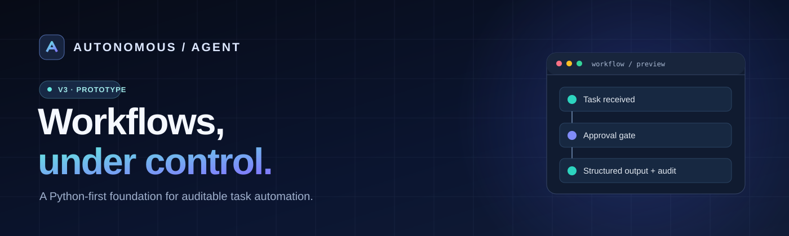
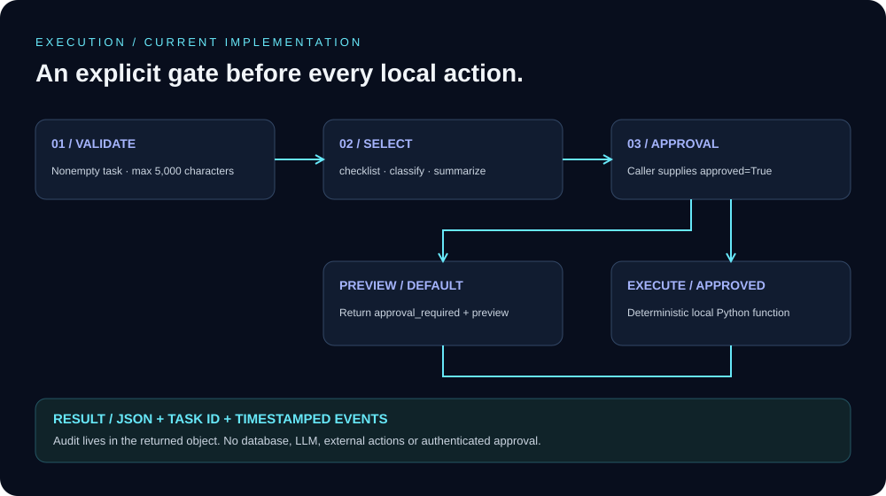
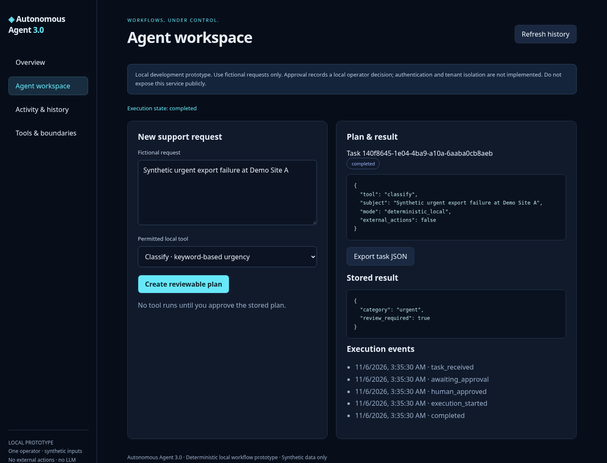
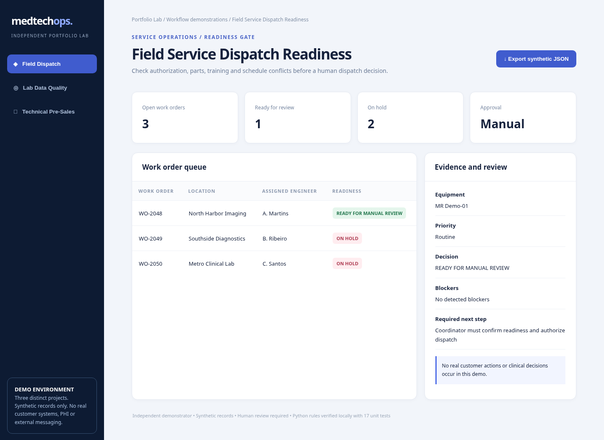

<div align="center">



# Autonomous Agent 3.0

**Workflows, under control.**

A local workflow automation prototype for technical support and service operations: submit a request, review its plan, approve a permitted tool, and inspect the stored result.

[](https://www.python.org/)


**[Get started](#quick-start) · [Product vision](#product-vision) · [Explore demos](#portfolio--demos) · [Architecture](#architecture) · [Commercial pilots](#commercial-pilots)**

</div>

---

## Review the request. Approve the work. Inspect the result.

For technical support and service operations teams exploring controlled automation: validate a task, choose an allowlisted local tool, explicitly approve execution, and inspect structured results. Start with the runnable prototype below; try the connected local operator workspace for persistent tasks and execution history.

| CONTROL | VISIBILITY | EXTENSIBILITY |
| :--- | :--- | :--- |
| Explicit approval before local execution | Structured results and timestamped events | Small Python modules and tested operations demos |

## Why this project?

Many teams lose time switching between tickets, spreadsheets, operational checklists and disconnected tools. Autonomous Agent explores how to orchestrate these workflows with **explicit permissions, structured results and traceability**.

> **Current maturity:** This repository contains working *prototype components* and independent synthetic-data demonstrations. The v3 core is deterministic and **does not use an LLM or perform external autonomous actions**. It is not production-ready.

## What exists today

| Component | Capability | Status |
| --- | --- | --- |
| **Agent v3 core** | Allowlisted actions, explicit approval, task IDs and structured outputs | Runnable prototype |
| **Command-line interface** | Run approved checklist, summary and classification flows | Runnable prototype |
| **Local API + storage** | Validated tasks, plan-bound approval, idempotency, pending cancellation | FastAPI + SQLite prototype |
| **Operator workspace** | Create, approve, inspect and export tasks; searchable history | Connected local web application |
| **Audit trail** | Timestamped events stored with execution results | SQLite via API; transient via CLI |
| **Portfolio lab** | Ticket triage, resilient API sync and fictional MedTech event analysis | Independent demos |
| **Operations showcase** | Dispatch readiness, lab data quality and pre-sales discovery | Independent demos |
| **Web showcase** | Read-only local demonstration interface | Demo, not SaaS |

## Quick start

Requires **Python 3.11+** for the API. The original CLI and independent demos still use only Python's standard library.

```bash
git clone https://github.com/ElhombreX21th/agente-autonomo.git
cd agente-autonomo
git switch upgrade/autonomous-agent-v3

python -m venv .venv
# Windows: .venv\Scripts\activate
. .venv/bin/activate
python -m pip install -r requirements-lock.txt

# Connected local workspace + API; default database: .agent-v3/tasks.sqlite3
python -m uvicorn agent_v3.api:create_app --factory --host 127.0.0.1 --port 8787
```

Open the local workspace on port 8787 and submit a fictional request. Review its stored plan before approving. Results and events survive service restarts. API schema is available at `/docs` and `/openapi.json`; liveness and storage readiness at `/health` and `/ready`.

```bash
# From the repository root, with the virtual environment active
python -m unittest discover -s tests -v
python -m unittest discover -s upwork_showcase_2026/tests -v
python -m agent_v3.cli --task "Review an urgent support ticket" --tool classify --approve
```

See [development and validation instructions](docs/DEVELOPMENT.md), including browser smoke tests. GitHub Actions runs the Python suites; remote CI status is reported separately from local results.

## Architecture



The diagram describes the original local CLI core. The new API stores a task and immutable plan hash in SQLite; approval executes that same stored task and commits its result and audit events atomically. The [architecture decision](docs/adr/001-local-workflow.md) describes transaction boundaries and the deliberate local-only scope.

**Safety by design:** no unrestricted shell tool, no automatic outbound network actions, and no silent execution in the v3 core. The API adds persistent audit storage. Authentication, tenant isolation, LLM providers and external connectors remain future work. Bind the service to loopback only.

## Portfolio & demos

### Python automation lab

Explore [portfolio_lab](portfolio_lab/README.md) for three independent demonstrations using fictional/synthetic inputs:

- **Support ticket triage:** assisted categorization with human review.
- **API synchronization:** resilient JSON synchronization backed by SQLite.
- **MedTech event analysis:** fictional event logs with cited fictional runbook entries.

```bash
python -m portfolio_lab.demo
python -m unittest discover -s tests -v
```

### Operations showcase

Explore [the showcase documentation](upwork_showcase_2026/README.md), [the web interface](upwork_showcase_2026/web/showcase.html) and the workflows:

| Demo | Business question |
| --- | --- |
| [Field Service Dispatch](upwork_showcase_2026/medtech_service_desk/logic.py) | Is a visit ready for dispatch? |
| [Laboratory Data Quality](upwork_showcase_2026/healthcare_data_quality/logic.py) | Which records require review? |
| [Technical Pre-Sales](upwork_showcase_2026/technical_presales_crm/logic.py) | What is the next qualified action? |

```bash
python -m unittest discover -s upwork_showcase_2026/tests -v
python -m upwork_showcase_2026.server
```

### Connected operator workspace



Real browser capture: a fictional request was submitted, approved and classified through the API. Stored results, JSON export and history were verified in the browser. This is deterministic automation, not LLM reasoning.

### Operations showcase, synthetic data



Actual browser capture of the read-only operations showcase. It is a separate working demo, not an agent execution dashboard. The [operator workspace illustration](docs/assets/autonomous-agent-dashboard.svg) remains a **design concept**.

## Roadmap

The [delivery roadmap](docs/ROADMAP.md) separates the implemented local backend and dashboard from upcoming AI, authentication and SaaS work. See the [implementation and commercialization notes](docs/UPGRADE_V3.md) for pricing hypotheses and licensing considerations.

## Commercial pilots

**Target workflows:** support ticket operations, field-service coordination, operational checklists, data-quality review and internal reporting.

**Engagement model under evaluation:** tailored pilot projects, setup/integration services and eventual monthly subscriptions. No pricing, service-level guarantees, production deployments or customer outcomes are represented as established.

Interested in evaluating a pilot? [Open a GitHub discussion via an issue](https://github.com/ElhombreX21th/agente-autonomo/issues/new) describing a workflow and its constraints. **Do not include credentials, patient information or confidential business data.**

## Brand assets

The [hero](docs/assets/autonomous-agent-hero-v4.svg), [symbol](docs/assets/autonomous-agent-mark.svg) and [execution architecture](docs/assets/execution-architecture-v4.svg) use a consistent navy, cyan and violet palette. Versioned filenames avoid reusing older GitHub image-cache paths. Legacy concept assets are retained for existing links; they are not product screenshots.

## Security, license & limitations

- Synthetic demonstration data only; not a clinical decision-support product.
- Never commit API keys, client records or sensitive operational details.
- Review dependency licenses and code ownership before commercial distribution.
- **No open-source license has been declared here.** Public visibility alone does not grant reuse or redistribution rights.
- This repository is a prototype/portfolio, not evidence of paid customers or production certification.

---

<div align="center">

**AUTONOMOUS AGENT 3.0**

*Build workflows you can inspect, approve and improve.*

Maintained by [ElhombreX21th](https://github.com/ElhombreX21th)

</div>
