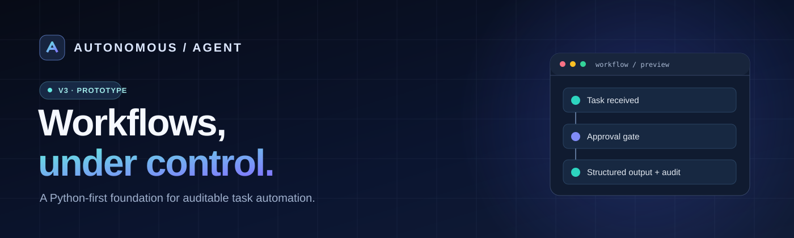
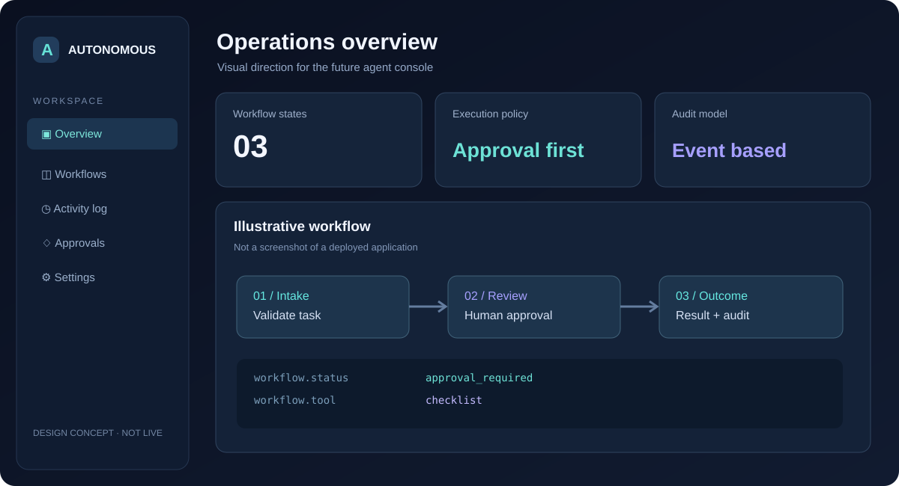
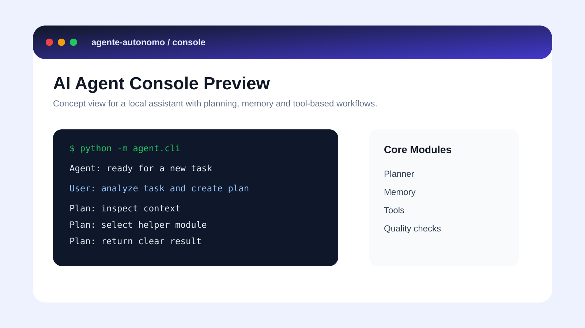
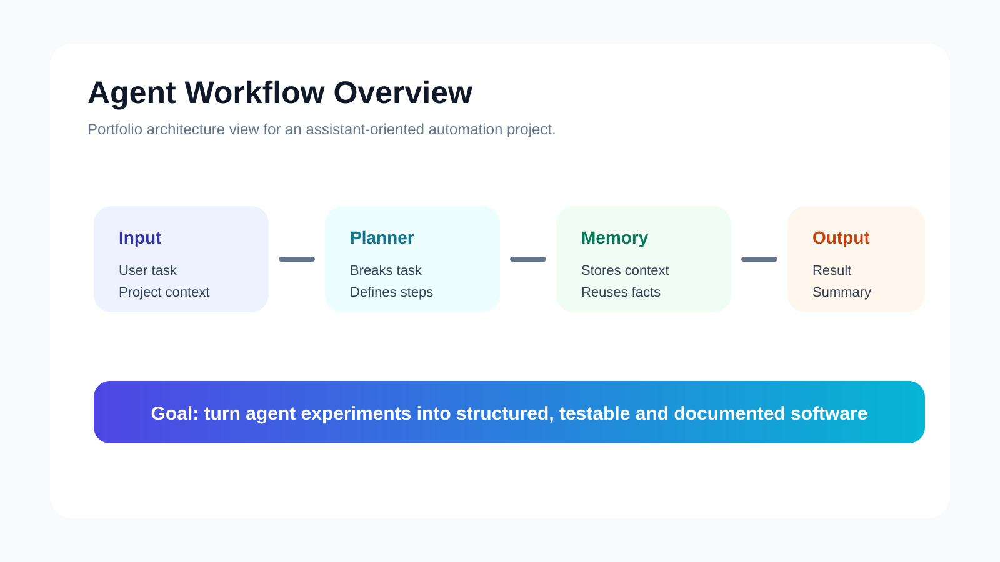

<div align="center">



# Autonomous Agent 3.0

**Workflows, under control.**

A Python-first automation project evolving toward a commercial AI agent platform for technical support, service operations and business workflows.

[](https://www.python.org/)


**[Get started](#quick-start) · [Product vision](#product-vision) · [Explore demos](#portfolio--demos) · [Architecture](#architecture) · [Commercial pilots](#commercial-pilots)**

</div>

---

## Product vision

<div align="center">



*Interface concept — a design direction, not a deployed dashboard or working SaaS.*

</div>

### Built for operational clarity

| CONTROL | VISIBILITY | EXTENSIBILITY |
| :--- | :--- | :--- |
| Explicit approval before executing local workflows | Structured task results and in-memory event records | Python modules and independent operational demos |

**The opportunity:** turn repetitive, reviewable business processes into reliable workflows. **The next milestone:** connect this prototype to authenticated services, persistent execution records and a real operator interface.

## Why this project?

Many teams lose time switching between tickets, spreadsheets, operational checklists and disconnected tools. Autonomous Agent explores how to orchestrate these workflows with **explicit permissions, structured results and traceability**.

> **Current maturity:** This repository contains working *prototype components* and independent synthetic-data demonstrations. The v3 core is deterministic and **does not yet use an LLM or perform external autonomous actions**. It is not production-ready.

## What exists today

| Component | Capability | Status |
| --- | --- | --- |
| **Agent v3 core** | Allowlisted actions, explicit approval, task IDs and structured outputs | Prototype in v3 branch |
| **Command-line interface** | Run approved checklist, summary and classification flows | Prototype in v3 branch |
| **Audit trail** | Timestamped execution events | In-memory only |
| **Portfolio lab** | Ticket triage, resilient API sync and fictional MedTech event analysis | Independent demos |
| **Operations showcase** | Dispatch readiness, lab data quality and pre-sales discovery | Independent demos |
| **Web showcase** | Read-only local demonstration interface | Demo, not SaaS |

## Quick start

Requires **Python 3.10+**. The v3 prototype uses only Python's standard library.

```bash
git clone https://github.com/ElhombreX21th/agente-autonomo.git
cd agente-autonomo
git switch upgrade/autonomous-agent-v3

# Preview a task; execution requires explicit approval
python -m agent_v3.cli --task "Review a support ticket" --tool checklist

# Run an approved local deterministic workflow
python -m agent_v3.cli --task "Review an urgent support ticket" --tool classify --approve

# Run the new v3 regression tests
python -m unittest discover -s tests -p "test_agent_v3.py" -v
```

The commands above are instructions for local verification; the new v3 tests have not yet been confirmed in CI.

## Architecture

```text
                      TASK REQUEST
                           |
                     Input validation
                           |
                    Tool allowlist
                           |
                    Approval required?
                      /          \
                    No            Yes
                    |              |
              Return preview   Execute local
              + wait           deterministic tool
                                     |
                             Structured result
                                     |
                            In-memory audit events
```

**Safety by design:** no unrestricted shell tool, no automatic outbound network actions, and no silent execution in the v3 core. Persistent audit storage, authentication and multi-tenant controls are future work.

## Portfolio & demos

### Python automation lab

Explore [portfolio_lab](portfolio_lab/README.md) for three independent demonstrations using fictional/synthetic inputs:

- **Support ticket triage:** assisted categorization with human review.
- **API synchronization:** resilient JSON synchronization backed by SQLite.
- **MedTech event analysis:** fictional event logs with cited fictional runbook entries.

```bash
python -m portfolio_lab.demo
python -m unittest discover -s tests -v
```

### Operations showcase

Explore [the showcase documentation](upwork_showcase_2026/README.md), [the web interface](upwork_showcase_2026/web/showcase.html) and the workflows:

| Demo | Business question |
| --- | --- |
| [Field Service Dispatch](upwork_showcase_2026/medtech_service_desk/logic.py) | Is a visit ready for dispatch? |
| [Laboratory Data Quality](upwork_showcase_2026/healthcare_data_quality/logic.py) | Which records require review? |
| [Technical Pre-Sales](upwork_showcase_2026/technical_presales_crm/logic.py) | What is the next qualified action? |

```bash
python -m unittest discover -s upwork_showcase_2026/tests -v
python -m upwork_showcase_2026.server
```

**Visual previews**

| Agent console | Workflow overview |
| --- | --- |
|  |  |

## Roadmap

- [x] Document initial agent architecture and portfolio examples
- [x] Add an isolated v3 deterministic agent core and CLI (development branch)
- [x] Add v3 unit tests (execution/CI validation pending)
- [ ] Persist task state and audit records
- [ ] Introduce authenticated API and tenant isolation
- [ ] Add pluggable LLM integration with structured output and spending limits
- [ ] Implement scoped tool connectors and human approval flows
- [ ] Build an operator dashboard and observability
- [ ] Validate security, reliability and costs with pilot users
- [ ] Launch commercial packaging and billing after validation

See the [v3 implementation and commercialization plan](docs/UPGRADE_V3.md).

## Commercial pilots

**Target workflows:** support ticket operations, field-service coordination, operational checklists, data-quality review and internal reporting.

**Engagement model under evaluation:** tailored pilot projects, setup/integration services and eventual monthly subscriptions. No pricing, service-level guarantees, production deployments or customer outcomes are represented as established.

Interested in evaluating a pilot? [Open a GitHub discussion via an issue](https://github.com/ElhombreX21th/agente-autonomo/issues/new) describing a workflow and its constraints. **Do not include credentials, patient information or confidential business data.**

## Brand assets

The [product banner](docs/assets/autonomous-agent-banner.svg), [symbol](docs/assets/autonomous-agent-mark.svg) and [dashboard concept](docs/assets/autonomous-agent-dashboard.svg) are versioned SVG assets. The dashboard illustration is not evidence of an implemented user interface.

## Security, license & limitations

- Synthetic demonstration data only; not a clinical decision-support product.
- Never commit API keys, client records or sensitive operational details.
- Review dependency licenses and code ownership before commercial distribution.
- **No open-source license has been declared here.** Public visibility alone does not grant reuse or redistribution rights.
- This repository is a prototype/portfolio, not evidence of paid customers or production certification.

---

<div align="center">

**AUTONOMOUS AGENT 3.0**

*Build workflows you can inspect, approve and improve.*

Maintained by [ElhombreX21th](https://github.com/ElhombreX21th)

</div>
